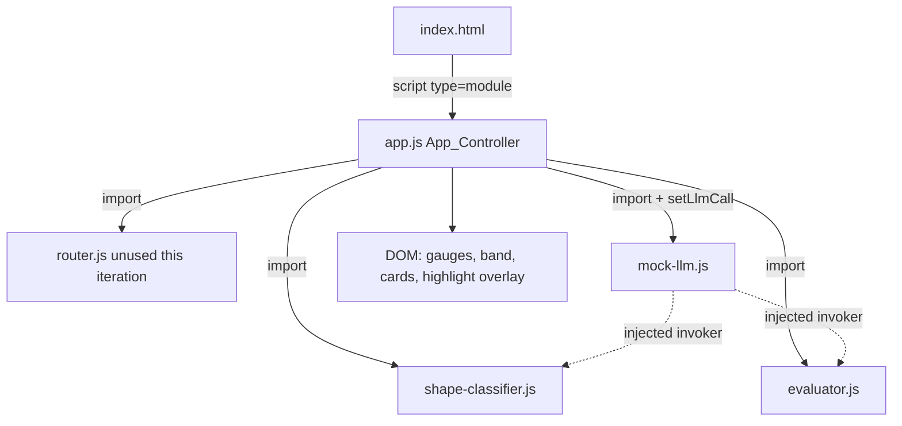
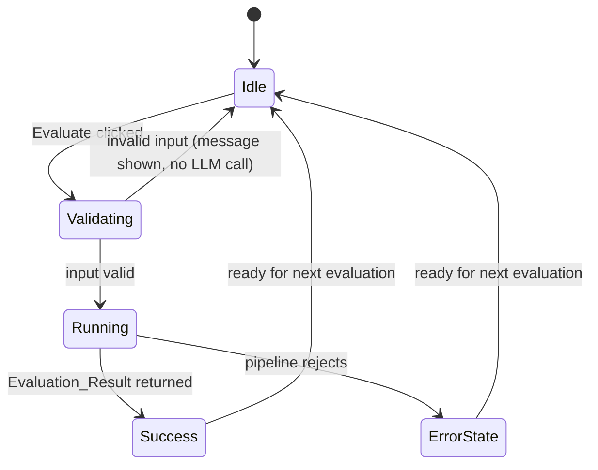

# Design Document

## Overview

EasyDawg Frontend is a zero-build, vanilla web interface for the existing EasyDawg admissions-essay reviewer. It presents a split-screen workspace: the left side holds a Common App prompt dropdown and an essay editor; the right side renders a feedback dashboard with six score gauges (one per backend dimension), an overall band, and UW feedback cards. When an essay is evaluated, the exact verbatim text spans that justify each dimension's score are highlighted in yellow in the essay display.

The frontend runs with no Node.js runtime, no bundler, and no transpile step. It is delivered as static files loaded directly in a browser (`file://`) or from any static file server.

### Confirmed decisions (settled, not open assumptions)

The three "Open Assumptions" in `requirements.md` have been resolved by the user and are treated as settled here:

1. **Six gauges, not five.** The dashboard renders exactly six `Score_Gauge`s, one per backend dimension: `focus`, `specificity`, `character`, `how_you_think`, `contribution`, `self_awareness`. The earlier "5" was a miscount.
2. **Prompt dropdown is display/context only.** The selected Common App prompt is shown for reviewer context and is **never** passed to `classifyShape`, `evaluateProfile`, or `evaluateEssay`. It does not alter any evaluation input or output.
3. **No student profile form this iteration.** The frontend does **not** collect a `StudentProfile` and does **not** call `evaluateProfile`. It passes an **empty modifiers record (`{}`)** directly to `evaluateEssay`. Because no profile is collected, there are no profile flags; the frontend renders **no profile-flags card content** (Requirement 9.5 has no input source this iteration and is satisfied vacuously — the flags card is omitted).

### Zero-build consumption of the TypeScript contracts (DECIDED)

The three source modules (`router.ts`, `shape-classifier.ts`, `evaluator.ts`) are TypeScript and cannot run in a browser without a transpile step, which the environment forbids. The resolution: **port the runtime logic from each `.ts` file into a plain browser-native ES module `.js` file** that strips the TypeScript type annotations but preserves the exact runtime behavior 1:1.

The port produces three module files imported by `app.js`:

- `router.js` — faithful port of `router.ts` (`evaluateProfile` + `addModifier`).
- `shape-classifier.js` — faithful port of `shape-classifier.ts` (`classifyShape` pipeline, parse/validate, 30s timeout, `setLlmCall` seam, error classes).
- `evaluator.js` — faithful port of `evaluator.ts` (`evaluateEssay` pipeline, schema + span/revision validation, retry loop, deterministic scoring/band, `setLlmCall` seam, error classes).

Separate module files (rather than folding all logic into `app.js`) are chosen for cleanliness and because each `.js` file maps 1:1 onto its `.ts` source, making the port auditable against the original. `router.js` is included so the ported contract set is complete even though this iteration does not call `evaluateProfile`.

**Port fidelity requirements** — the `.js` ports MUST preserve, byte-for-byte in behavior:

- From `router.ts`: `evaluateProfile` modifier/flag logic and the `addModifier` accumulation.
- From `shape-classifier.ts`: the `classifyShape` stage pipeline (`assertNonEmptyEssay` → `buildMessages` → `invokeLlm` → `parseResponse` → `validateResult`), the `SYSTEM_PROMPT` text verbatim, the `LLM_TIMEOUT_MS = 30000` timeout enforced via `Promise.race` + `AbortController`, the `setLlmCall` seam, and the error classes `EssayRequiredError`, `ClassificationFailedError`, `ClassificationTimeoutError`, `InvalidResponseError`.
- From `evaluator.ts`: the `evaluateEssay` pipeline, `MAX_ESSAY_LENGTH = 20000` and `MAX_ATTEMPTS = 3`, the schema validation (`validateLlmEvaluation`), the span/revision validation (`validateSpansAndRevisions`), the retry loop (retry only on span/revision fault; JSON-syntax, schema, timeout, and transport faults are not retried), the deterministic scoring chain `scoreDimensions → applyProfileModifiers → computeTotalScore → deriveBand`, the `setLlmCall` seam, and the error classes `EssayRequiredError`, `EvaluationFailedError`, `EvaluationTimeoutError`, `InvalidResponseError`.

Ported constants that the UI depends on:

- `BASE_VALUES`: `focus 25`, `specificity 25`, `character 20`, `how_you_think 20`, `contribution 15`, `self_awareness 10` (sum 115).
- Band thresholds (inclusive upper bounds): `0–23 → 1`, `24–46 → 2`, `47–69 → 3`, `70–92 → 4`, `93–115 → 5`.

> Because each error class is defined independently in each module, `app.js` MUST distinguish them by their `.name` string (`"ClassificationTimeoutError"`, `"EvaluationTimeoutError"`, etc.) and/or by `instanceof` against the class imported from the matching module, not by a single shared class.

### LLM seam strategy (DECIDED): mock invoker

The `setLlmCall` seam in both `shape-classifier.js` and `evaluator.js` defaults to a stub that throws. The frontend injects a **single mock LLM invoker** (`mock-llm.js`) into both modules via `setLlmCall` before any pipeline stage runs. The mock returns realistic, **hardcoded, schema-valid JSON** and branches on the request so one function serves both modules:

- If the request's `systemPrompt` is the classifier prompt (detected by a stable marker — the classifier prompt contains `"classify the structural SHAPE"` / the `SHAPE RULES` heading), the mock returns `{ shape, circularity, reasoning }`.
- Otherwise (the evaluator prompt, detected by the evaluator schema markers such as `"DIMENSIONS AND BASE VALUES"` / `"VERBATIM SPAN RULE"`), the mock returns the full evaluator object `{ dimensions{6}, mechanics_pass, mechanics_errors, revisions[3], claims }`.

The evaluator mock's spans and revision `original`s are **exact verbatim substrings** of a bundled sample essay that the demo pre-populates into the essay editor. This guarantees:

1. Every one of the six dimension spans passes `validateSpansAndRevisions` (`essayText.includes(span)` is true).
2. Each of the exactly three revision `original`s is a verbatim substring, so the exactly-three-revisions check passes.
3. The yellow highlights land on real text in the essay editor.

Because the demo invoker is in use, a persistent **demo-mode indicator** is displayed (Req 11.5).

## Architecture

### File inventory

| File | Role |
| --- | --- |
| `index.html` | Document structure: split-screen layout, loads `app.js` as `<script type="module">`. |
| `styles.css` | All styling: split-screen grid, responsive stacking, gauges, cards, highlight overlay, focus indicators. |
| `app.js` | `App_Controller`: reads inputs, injects the mock via `setLlmCall`, orchestrates the pipeline, renders results, manages highlights and UI state. |
| `router.js` | Ported `evaluateProfile` (present for contract completeness; not invoked this iteration). |
| `shape-classifier.js` | Ported `classifyShape` + seam + error classes. |
| `evaluator.js` | Ported `evaluateEssay` + seam + deterministic scoring + error classes. |
| `mock-llm.js` | The demo LLM invoker and the bundled sample essay + matching hardcoded responses. |

> Requirement 1.1 names "exactly three files." That count predates the confirmed zero-build port decision, which necessarily adds the ported `.js` modules and the mock. The confirmed decision (convert the `.ts` logic into `.js` ES modules imported by `app.js`) supersedes the literal three-file count. All files remain static, no-build assets, satisfying the intent of Requirement 1 (Req 1.2, 1.3, 1.4, 1.5).

### Module graph



### Pipeline sequence

```mermaid
sequenceDiagram
  participant R as Reviewer
  participant A as App_Controller (app.js)
  participant C as classifyShape (shape-classifier.js)
  participant E as evaluateEssay (evaluator.js)
  participant M as mock-llm.js

  R->>A: Click "Evaluate"
  A->>A: read Essay_Input text
  A->>A: validate (non-empty, <= 20000 chars)
  alt invalid input
    A-->>R: input-validation message; no LLM call
  else valid
    A->>A: setLlmCall(mock) on both modules
    A->>A: show in-progress; disable action
    A->>C: classifyShape(essayText)
    C->>M: invoker(req, 30000)
    M-->>C: { shape, circularity, reasoning }
    C-->>A: Classification_Result
    Note over A: no profile -> modifiers = {} ; evaluateProfile NOT called
    A->>E: evaluateEssay(essayText, {}, shape)
    E->>M: invoker(req, 30000)
    M-->>E: { dimensions{6}, mechanics_pass, mechanics_errors, revisions[3], claims }
    E-->>A: Evaluation_Result (band computed in code)
    A->>A: render band, 6 gauges, cards, highlights
    A-->>R: feedback + highlights; re-enable action
  end
```

The order is strictly `classifyShape` → (no `evaluateProfile`) → `evaluateEssay` (Req 6.1, 6.4, 6.5). `evaluateProfile` is never called this iteration (Req 6.4); the empty `{}` modifiers flow directly into `evaluateEssay`.

### App_Controller responsibilities

- Seam injection: on module load (or before the first evaluation), call `setLlmCall(mockInvoker)` on both `shape-classifier.js` and `evaluator.js` so no stage ever hits the throwing default stub (Req 11.1).
- Input gate: read the essay text, reject empty/whitespace and >20000-char input before any LLM call (Req 5.3, 5.4, 6.2).
- Orchestration: run the pipeline in order, mapping each thrown error class to a UI state (Req 12).
- Rendering: render exactly from the returned `Classification_Result` and `Evaluation_Result` values; never substitute a frontend-computed value (Req 2.1, 8.2).
- Highlight management: locate spans, build the overlay, clear highlights on edit (Req 10).
- UI state machine: idle → running → (success | error), including the loading/timeout/failed/invalid states (Req 12).

## Components and Interfaces

### Layout (`index.html` + `styles.css`)

Split-screen using CSS grid/flex (Req 3):

- **Left region** — `Prompt_Selector` (`<select>`), selected-prompt text display, `Essay_Input` editor (the highlight surface, see below), and the "Evaluate" action button.
- **Right region** — `Feedback_Dashboard`: demo-mode indicator, status/error area, band display, six gauges, UW feedback cards.

Responsive: a `@media (max-width: …)` breakpoint switches the two-column grid to a single column so the regions stack and both remain reachable by scrolling (Req 3.4).

### Prompt_Selector (Req 4)

A `<select>` listing the seven standard 2024–2025 Common App essay prompts, exactly one selectable at a time. On change, the full prompt text is shown in the left region. The selection is **display/context only** and is never passed to any module (Req 4.4).

The seven Common App prompts (2024–2025, unchanged for 2024–2025):

1. Some students have a background, identity, interest, or talent that is so meaningful they believe their application would be incomplete without it. If this sounds like you, then please share your story.
2. The lessons we take from obstacles we encounter can be fundamental to later success. Recount a time when you faced a challenge, setback, or failure. How did it affect you, and what did you learn from the experience?
3. Reflect on a time when you questioned or challenged a belief or idea. What prompted your thinking? What was the outcome?
4. Reflect on something that someone has done for you that has made you happy or thankful in a surprising way. How has this gratitude affected or motivated you?
5. Discuss an accomplishment, event, or realization that sparked a period of personal growth and a new understanding of yourself or others.
6. Describe a topic, idea, or concept you find so engaging that it makes you lose all track of time. Why does it captivate you? What or who do you turn to when you want to learn more?
7. Share an essay on any topic of your choice. It can be one you've already written, one that responds to a different prompt, or one of your own design.

### Essay_Input / Essay_Display and the highlight mechanism (Req 10)

A `<textarea>` cannot render inline highlights. **Chosen approach: the backdrop-overlay technique.**

Structure (a single positioned container):

```
.essay-field (position: relative)
├── .essay-backdrop   (absolutely positioned, behind, same box metrics; holds highlight <mark> spans)
└── textarea.essay-input (transparent text + visible caret, on top, same box metrics)
```

- The reviewer types/pastes into the real `<textarea>` (so editing, caret, selection, and accessibility all work natively — Req 5.1).
- The `<textarea>` text color is transparent (the caret stays visible via `caret-color`); the visible glyphs the reviewer reads come from the `.essay-backdrop` rendered directly behind the textarea.
- The backdrop and textarea share identical font, font-size, line-height, padding, border, width, and `white-space: pre-wrap; word-break: break-word;` so glyphs align exactly. The backdrop scrolls in sync with the textarea via a `scroll` listener.
- Line breaks and whitespace are preserved by `white-space: pre-wrap` on the backdrop and by escaping the essay text into the backdrop as text nodes (never `innerHTML` of raw essay content), so the essay's original characters, whitespace, and line breaks are preserved exactly (Req 10.2, 10.7).

Rationale for the overlay over a `contenteditable` surface: a native `<textarea>` gives correct multiline plain-text editing, keyboard behavior, and a predictable value with no rich-text or sanitization pitfalls; `contenteditable` would complicate exact-substring offset math and risk inserting markup into the essay value.

**Span location algorithm** (runs after a successful `Evaluation_Result`):

1. Collect the six dimension spans from `Evaluation_Result.dimensions` (keyed by dimension).
2. For each span, find its **first occurrence** as an exact, case-sensitive substring of the current essay text using `text.indexOf(span)` counting from index 0 (Req 10.2, 10.3). A span found at index `i` yields the half-open range `[i, i + span.length)`.
3. If `indexOf` returns `-1`, the span is **not located**: skip its highlight and record a visible, dimension-associated "span could not be located" indication on that dimension's gauge (Req 10.5).
4. **Overlap union.** Collect all located ranges. Build a boolean coverage mask over the essay (or merge the ranges into a sorted, union-merged set of non-overlapping intervals). A character is highlighted iff it is covered by **at least one** located span. Overlapping or identical ranges produce a single contiguous yellow highlight with the **same** yellow as non-overlapping highlights — no darker/blended color for overlaps (Req 10.4).
5. Render the backdrop as a sequence of text segments: plain text for uncovered runs and `<mark class="hl">`-wrapped text for covered runs, with all essay characters escaped. Each highlighted run carries a non-color indicator and a dimension association for accessibility (Req 13.2, 13.3).

**Non-color indicator** (Req 13.2): highlighted `<mark>` runs also carry an underline (`text-decoration: underline`) and a leading/trailing marker is avoided to keep offsets intact; the underline plus a `role`/`aria` annotation conveys the highlight without relying on color. Each `<mark>` gets `aria-label` naming the contributing dimension(s), e.g. `aria-label="Highlighted: focus, specificity"`, making the highlight-to-dimension relationship programmatically determinable (Req 13.3).

**Clearing on edit** (Req 10.6): an `input` listener on the `<textarea>` clears all `<mark>` runs (resetting the backdrop to plain escaped text) and removes all span-not-located indications, so a stale highlight never survives an edit into the next evaluation.

### Score_Gauge rendering (Req 7, 13.1)

Six gauges, one per dimension in canonical order (`focus`, `specificity`, `character`, `how_you_think`, `contribution`, `self_awareness`). Each gauge shows:

- A human-readable label (e.g. `how_you_think` → "How You Think") (Req 7.4).
- A visual meter: a bar whose filled fraction is `score / base_value` for that dimension (Req 7.2). When `score === base_value` the meter renders full (Req 7.5). The meter uses the ported `BASE_VALUES` for the denominator.
- The numeric `score` and the dimension's `reasoning` text, both taken verbatim from `Evaluation_Result.dimensions[key]` (Req 7.3, 2.1).
- A span-not-located indication slot (populated only when that dimension's span was not found — Req 10.5).

**Accessible text alternative** (Req 13.1): each gauge exposes its dimension name, `score`, and `base_value` as programmatically determinable text — implemented with `role="meter"` plus `aria-valuenow`, `aria-valuemin="0"`, `aria-valuemax="{base_value}"`, and `aria-label="{Dimension name}: {score} of {base_value}"`. Gauges always render as six (Req 7.1), never recomputed in the frontend.

### Band display (Req 8)

The `Feedback_Dashboard` shows `Evaluation_Result.band` as an integer 1–5, displayed exactly as returned (computed in `evaluator.js` via `deriveBand`), never recomputed in the frontend (Req 8.1, 8.2).

### UW_Feedback_Cards (Req 9)

Rendered below the gauges, sourced entirely from `Evaluation_Result`:

- **Mechanics card** (Req 9.2, 9.3): when `mechanics_pass` is `false`, list each string in `mechanics_errors`; when `true`, show a pass indicator and no error entries.
- **Revisions card** (Req 9.4): exactly the three entries in `revisions`, each rendering `original`, `suggested`, and `reasoning`.
- **Claims card** (Req 9.6, 9.7): each string in `claims`; when `claims` is empty, render no claim entries.
- **Profile flags card**: **omitted this iteration.** No `StudentProfile` is collected and `evaluateProfile` is not called, so there is no `flags` source; the card has no content and is not rendered (Req 9.5 satisfied vacuously).

### LLM seam + demo mode (Req 11)

`app.js` imports the mock invoker from `mock-llm.js` and calls `setLlmCall(mockInvoker)` on both `shape-classifier.js` and `evaluator.js` before any pipeline stage (Req 11.1), so no stage runs against the throwing default stub. A persistent, visible **demo indicator** states that demo responses are in use while the mock is active (Req 11.5). If a pipeline stage ever rejects with `InvalidResponseError`, the frontend shows an "invalid response" message and renders no partial scores (Req 11.3, 12.4).

### App_Controller UI state machine (Req 12)



While `Running`: show an in-progress indicator and disable the Evaluate action (Req 12.1). On settle (success or failure): remove the indicator and re-enable the action (Req 12.6).

## Data Models

The frontend consumes the module contracts exactly as defined; it introduces no competing models (Req 2.2).

### From `shape-classifier.js` — `Classification_Result`

```
{
  shape: "linear" | "motif",
  circularity: boolean,
  reasoning: string            // one sentence, <= 2000 chars enforced by validateResult
}
```

### From `evaluator.js` — `Evaluation_Result`

```
{
  band: number,                // integer 1..5, computed by deriveBand (never from LLM)
  mechanics_pass: boolean,
  mechanics_errors: string[],  // empty iff mechanics_pass === true
  dimensions: {
    focus:          { score: number, span: string, reasoning: string },
    specificity:    { score: number, span: string, reasoning: string },
    character:      { score: number, span: string, reasoning: string },
    how_you_think:  { score: number, span: string, reasoning: string },
    contribution:   { score: number, span: string, reasoning: string },
    self_awareness: { score: number, span: string, reasoning: string }
  },
  revisions: [                 // EXACTLY 3 entries
    { original: string, suggested: string, reasoning: string }, x3
  ],
  claims: string[]
}
```

Constants (ported, used by the UI): `BASE_VALUES = { focus:25, specificity:25, character:20, how_you_think:20, contribution:15, self_awareness:10 }`; band thresholds `0–23→1, 24–46→2, 47–69→3, 70–92→4, 93–115→5`.

### Frontend-internal view models

- `DimensionLabelMap`: `{ focus:"Focus", specificity:"Specificity", character:"Character", how_you_think:"How You Think", contribution:"Contribution", self_awareness:"Self-Awareness" }`.
- `HighlightRange`: `{ start: number, end: number, dimensions: string[] }` — union-merged intervals over the essay text, `end` exclusive.
- `UiState`: `"idle" | "running" | "success" | "error"`, plus an error descriptor `{ kind, message }` where `kind` is derived from the thrown error's `.name`.

### Sample essay and matching mock responses

The demo pre-populates this exact sample essay into the `Essay_Input`. Every mock span and revision `original` below is a verbatim substring of it.

**Sample essay (bundled in `mock-llm.js`, pre-populated into the editor):**

```
The metronome on my piano ticked like a second heartbeat. I was seven, and its steady arm terrified me because it never slowed down to wait for my clumsy fingers. For years I treated that ticking as an enemy, a judge counting every mistake I made during practice.

In middle school I joined the robotics team, where I learned that rhythm was not a punishment but a tool. We timed our autonomous routines to the half second, and I began to hear the metronome differently, as a partner that kept us honest about what we could actually achieve.

By senior year I was teaching younger students to code, and I caught myself tapping out a steady beat on the desk while they debugged. The metronome had followed me out of the music room and into everything I cared about. Its ticking was no longer a judge but a reminder that steady effort, repeated over time, is how clumsy fingers eventually learn to fly.
```

**Mock classifier response** (returned when the classifier prompt is detected):

```json
{
  "shape": "motif",
  "circularity": true,
  "reasoning": "The metronome recurs from the opening scene to the closing line, anchoring the narrative as a motif."
}
```

**Mock evaluator response** (returned when the evaluator prompt is detected). Each `span` and each revision `original` is an exact substring of the sample essay above:

```json
{
  "dimensions": {
    "focus":          { "score": 22, "span": "The metronome had followed me out of the music room and into everything I cared about.", "reasoning": "The metronome motif keeps a single controlling idea in view across the whole timeline." },
    "specificity":    { "score": 21, "span": "We timed our autonomous routines to the half second", "reasoning": "Concrete, specific detail grounds the reflection in a real experience." },
    "character":      { "score": 17, "span": "For years I treated that ticking as an enemy, a judge counting every mistake I made during practice.", "reasoning": "Shows honest self-portraiture and growth in attitude." },
    "how_you_think":  { "score": 16, "span": "I learned that rhythm was not a punishment but a tool.", "reasoning": "Demonstrates reframing and reflective reasoning." },
    "contribution":   { "score": 12, "span": "By senior year I was teaching younger students to code", "reasoning": "Evidence of contribution to a community." },
    "self_awareness": { "score": 9,  "span": "steady effort, repeated over time, is how clumsy fingers eventually learn to fly", "reasoning": "Names a durable lesson about the self." }
  },
  "mechanics_pass": true,
  "mechanics_errors": [],
  "revisions": [
    { "original": "The metronome on my piano ticked like a second heartbeat.", "suggested": "On my piano, the metronome ticked like a second heartbeat, insistent and unignorable.", "reasoning": "Front-loading the image sharpens the opening." },
    { "original": "In middle school I joined the robotics team, where I learned that rhythm was not a punishment but a tool.", "suggested": "In middle school, robotics taught me that rhythm was a tool, not a punishment.", "reasoning": "Tighter phrasing reduces wordiness." },
    { "original": "Its ticking was no longer a judge but a reminder that steady effort, repeated over time, is how clumsy fingers eventually learn to fly.", "suggested": "Its ticking was no longer a judge but a reminder: steady effort, repeated over time, teaches clumsy fingers to fly.", "reasoning": "A colon and trimmed clause strengthen the closing line." }
  ],
  "claims": ["UW-RESOURCE-TIME-MGMT", "UW-RESOURCE-STEM-TUTORING"]
}
```

With these values the deterministic scoring yields a total of `22 + 21 + 17 + 16 + 12 + 9 = 97`, which `deriveBand` maps to band `5` (93–115). The empty `{}` modifiers leave every base-value score unchanged.

## Correctness Properties

*A property is a characteristic or behavior that should hold true across all valid executions of a system — essentially, a formal statement about what the system should do. Properties serve as the bridge between human-readable specifications and machine-verifiable correctness guarantees.*

The properties below target the frontend's deterministic, pure logic — the ported scoring/band pipeline and the span-location/highlight computation — which are the parts with meaningful input variation. The DOM wiring, layout, prompt dropdown, and loading/error presentation are covered by example-based and integration tests in the Testing Strategy (they are not universally quantifiable over a large input space).

### Property 1: Band is always an integer in 1–5

For any finalized six-dimension score set whose per-dimension scores lie in `[0, BASE_VALUES[key]]`, `deriveBand(computeTotalScore(dimensions))` returns an integer in the inclusive range `[1, 5]`.

**Validates: Requirements 8.1**

### Property 2: Total score equals the sum of the six dimension scores

For any finalized six-dimension score set, `computeTotalScore(dimensions)` equals the arithmetic sum of the six dimension `score` values.

**Validates: Requirements 8.1, 8.2**

### Property 3: Rendered band equals `Evaluation_Result.band`

For any `Evaluation_Result`, the band value rendered in the `Feedback_Dashboard` equals `Evaluation_Result.band` exactly, with no recomputation in the frontend.

**Validates: Requirements 2.1, 8.2**

### Property 4: Exactly six gauges are rendered

For any `Evaluation_Result`, rendering the dashboard produces exactly six `Score_Gauge`s, one per canonical dimension key, each displaying the `score` and `reasoning` from the corresponding `Evaluation_Result.dimensions` entry.

**Validates: Requirements 7.1, 7.3**

### Property 5: Empty or whitespace-only essay never invokes the LLM mock

For any essay string that is empty or consists solely of whitespace, requesting an evaluation does not invoke the mock LLM invoker for either `classifyShape` or `evaluateEssay`, and the frontend shows an input-validation message.

**Validates: Requirements 5.3, 6.2**

### Property 6: Over-length essay never invokes `evaluateEssay`

For any essay string strictly longer than 20000 characters, requesting an evaluation does not invoke `evaluateEssay`, and the frontend shows the over-length message.

**Validates: Requirements 5.4, 6.2**

### Property 7: Every located highlight corresponds to an exact substring

For any essay text and any set of dimension spans, every `HighlightRange` the frontend produces covers a run of characters `essayText[start:end]` such that at least one contributing span equals that exact substring, and each located span's range starts at the first occurrence (lowest index) of that span in the essay text.

**Validates: Requirements 10.2, 10.3**

### Property 8: Overlapping spans produce a single uniform union highlight

For any set of dimension spans located in the essay text, a character is highlighted if and only if it is covered by at least one located span, and every highlighted character carries the identical yellow highlight style (no distinct overlap styling).

**Validates: Requirements 10.4**

### Property 9: Unlocated spans are skipped and flagged, never fabricated

For any dimension whose span is not a substring of the current essay text, the frontend produces no `HighlightRange` for that dimension and records exactly one dimension-associated "span not located" indication for it.

**Validates: Requirements 10.5**

### Property 10: Highlighting preserves the essay's characters

For any essay text, the concatenation of the backdrop's rendered text segments (with markup removed and HTML-escaping reversed) equals the original essay text exactly, including all whitespace and line breaks.

**Validates: Requirements 10.2, 10.7**

### Property 11: Empty modifiers preserve base-value scores

For any schema-valid LLM evaluation, applying an empty `{}` modifiers record leaves every dimension `score` equal to its base-value score from the LLM response (no modifier is ever applied this iteration).

**Validates: Requirements 6.4**

## Error Handling

All pipeline errors surface as the named error classes from the ported modules. `app.js` branches on the error's `.name` (and/or `instanceof` against the class from the originating module) and maps each to a distinct UI message, never rendering a fabricated or partial result (Req 2.4, 6.7, 6.8, 11.3, 12).

| Condition | Error class (`.name`) | Origin | UI response |
| --- | --- | --- | --- |
| Essay empty / whitespace-only / over-length | `EssayRequiredError` | classifier/evaluator | Input-validation message; essay is required and must be ≤ 20000 chars. Caught before the call by the app's own input gate, and also defended by the module (Req 5.3, 5.4, 6.2, 12.5). |
| Classifier timed out (30s) | `ClassificationTimeoutError` | classifier | Timeout message: model did not respond within 30 seconds (Req 12.2). |
| Evaluator timed out (30s) | `EvaluationTimeoutError` | evaluator | Timeout message: model did not respond within 30 seconds (Req 12.2). |
| Classifier request failed (transport/rejection) | `ClassificationFailedError` | classifier | Evaluation-failed message (Req 12.3). |
| Evaluator request failed (transport/rejection) | `EvaluationFailedError` | evaluator | Evaluation-failed message (Req 12.3). |
| Malformed JSON / schema / unrecoverable span-revision fault | `InvalidResponseError` | either | Invalid-response message; no partial scores (Req 11.3, 12.4). |
| Modules not loaded (import failed) | import failure (no result) | app | "Evaluation modules are not loaded" message; render nothing (Req 2.3). |
| Seam is the throwing default stub | thrown by stub, wrapped as `*FailedError` | either | "LLM is not configured" message; render nothing, leave essay unchanged (Req 11.2). Prevented in practice by injecting the mock first (Req 11.1). |

Error-handling rules:

- On **any** classifier failure, `evaluateEssay` is not called and no band/gauges/cards/highlights render (Req 6.7).
- On **any** evaluator failure, no band/gauges/cards/highlights render (Req 6.8).
- On settle (success or failure), the in-progress indicator is removed and the Evaluate action is re-enabled (Req 12.6).
- The app's input gate rejects empty/whitespace/over-length input before any LLM call, so `classifyShape`/`evaluateEssay` are not invoked for invalid input (Req 5.3, 5.4, 6.2) — a defense-in-depth match to the modules' own `assertNonEmptyEssay`.

## Testing Strategy

A dual approach: property-based tests for the deterministic/pure logic, and example-based and integration tests for the DOM, orchestration, error mapping, and the display-only prompt behavior.

### Property-based tests

PBT applies to the ported deterministic scoring pipeline and the span-location/highlight computation, which have large, meaningful input spaces. The frontend uses **fast-check** (loaded as a static ES module asset, consistent with the zero-build constraint; used only in the test harness, not shipped to the demo page). Each property test:

- Runs a **minimum of 100 iterations**.
- Is tagged with a comment: `// Feature: easydawg-frontend, Property {number}: {property text}`.
- Implements exactly one of the Correctness Properties above.

Coverage map: Property 1–2 and 11 test the ported `computeTotalScore`/`deriveBand`/`applyProfileModifiers`; Property 4 tests gauge rendering count/content against a generated `Evaluation_Result`; Property 5–6 test the input gate with generated empty/whitespace/over-length strings asserting the mock invoker is never called (spy); Property 7–10 test the span-location/union/escape logic with generated essays and span sets.

### Example-based unit tests

- Band boundary examples: totals `23→1`, `24→2`, `46→2`, `47→3`, `69→3`, `70→4`, `92→4`, `93→5`, `0→1`, `115→5`.
- Prompt dropdown: selecting each of the seven prompts shows its text and passes no prompt to any module (assert module call arguments) (Req 4.3, 4.4).
- Mechanics card: `mechanics_pass:true` shows pass indicator and no errors; `false` lists each error (Req 9.2, 9.3).
- Revisions card renders exactly three entries with `original`/`suggested`/`reasoning` (Req 9.4).
- Claims card: non-empty renders entries; empty renders none (Req 9.6, 9.7).
- No profile-flags card is rendered (Req 9.5 vacuous this iteration).
- Clear-on-edit: after a render, an `input` event clears all `<mark>` runs and span-not-located indications (Req 10.6).
- Accessibility: each gauge exposes `role="meter"` with `aria-valuenow`/`aria-valuemax` and a text label (Req 13.1); highlights carry a non-color indicator and dimension `aria-label` (Req 13.2, 13.3); focus indicators present on selector, input, and action (Req 13.4).

### Integration tests (mock-driven, 1–3 examples each)

- End-to-end demo flow: pre-populated sample essay → inject mock → `classifyShape` → `evaluateEssay` → six gauges, band 5, three revisions, two claims, and highlights landing on the six verbatim spans.
- Error mapping: a mock that throws each error class (`ClassificationTimeoutError`, `EvaluationTimeoutError`, `ClassificationFailedError`, `EvaluationFailedError`, `InvalidResponseError`) surfaces the correct UI message and renders no partial results (Req 12.2–12.4, 6.7, 6.8).
- Demo indicator visible while the mock is the active invoker (Req 11.5).
- Responsive stacking at a narrow viewport (Req 3.4) — snapshot/visual check.

### Mock verification

A dedicated test asserts the bundled mock evaluator response is self-consistent against the bundled sample essay: all six spans and all three revision `original`s are exact substrings, so the ported `validateSpansAndRevisions` accepts the response on the first attempt (no retry, no `InvalidResponseError`). This guards the demo against regressions in either the sample essay or the mock payload.
