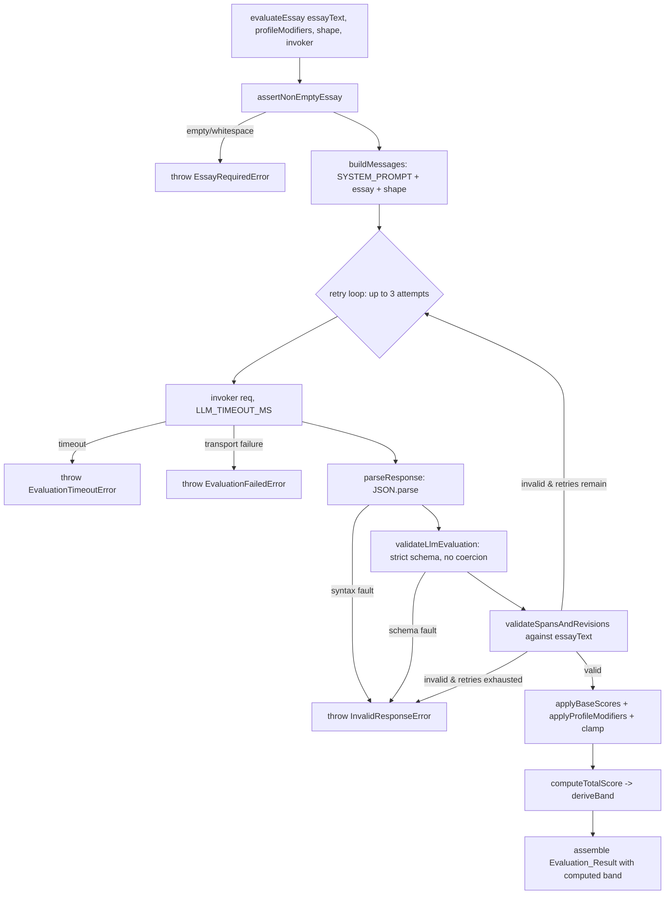

# Design Document

## Overview

The Essay Evaluator is the third stage of the EasyDawg admissions pipeline. It is a single TypeScript module, `evaluator.ts`, whose public entry point is the async `evaluateEssay(essayText, profileModifiers, shape, invoker?)` function. It reads a student's application essay and produces a structured, deterministic `Evaluation_Result`: an overall `band` (1–5), a mechanics pass/fail with enumerated errors, a six-dimension score breakdown (each anchored to a verbatim quote from the essay), exactly three sentence-level revisions, and a list of opaque UW resource-hub claim identifiers.

The module is a direct sibling of `shape-classifier.ts` and mirrors its architecture exactly:

- A fixed `SYSTEM_PROMPT` constant encoding every scoring rule.
- An injectable LLM seam (`setLlmCall` / `LlmInvoker`) with a default stub that throws when the Kiro LLM SDK binding is not configured.
- An in-code timeout wrapper governed by `LLM_TIMEOUT_MS` (30_000) using `AbortController` + `Promise.race`.
- Strict, deterministic `parseResponse` (JSON syntax) and `validateResult` (schema, no coercion) stages kept separate from the LLM call.
- Named error classes extending `Error` with a `name` property.

The design makes two judgments deterministic rather than trusting the model:

1. **The `band` is computed by the evaluator, never by the LLM** (Req 13.5, Req 14). The LLM returns only dimensions, mechanics, revisions, and claims. The evaluator applies profile modifiers to the dimension scores, sums them into a `Total_Score`, and maps that onto the 1–5 band scale.
2. **The verbatim-span and exactly-three-revisions rules are enforced as deterministic validations** that reject the response and retry the LLM (up to 2 retries, 3 total attempts), rather than being left to the model's discretion (Req 6, Req 7).

Because the project has no confirmed Kiro LLM SDK binding (no `package.json` / `node_modules`), the concrete model call remains a stub behind the injectable seam, exactly as in `shape-classifier.ts`.

### Upstream inputs

- `profileModifiers` is sourced from the `modifiers` field of `router.ts`'s `evaluateProfile`. Note that `router.ts` emits **title-case** keys such as `"Character"` and `"Contribution"`, while the dimension keys in the result are **lowercase** (`character`, `contribution`). The modifier application uses a case-insensitive match to bridge this difference (Req 4.2).
- `shape` is sourced from the `shape` field of `shape-classifier.ts`'s `classifyShape`, one of `"linear"` or `"motif"`. It selects which Focus anchors apply (Req 5).

## Architecture

### Processing pipeline

The `evaluateEssay` orchestrator runs a sequence of stages. The LLM invoke → parse → validate steps are wrapped in a retry loop; the deterministic scoring and band derivation run once on the accepted response.



### Retry loop

The span and revision checks (Req 6.3, Req 7.4) are the only validations that trigger a retry. A schema fault from `validateLlmEvaluation` (missing field, wrong type) and a JSON syntax fault from `parseResponse` surface immediately as `InvalidResponseError` without retry — those indicate a malformed response rather than a plausibly-recoverable anchoring mistake. The loop structure is:

- Attempt 1 (initial) → up to 2 further retries = **3 total attempts**.
- Each attempt: `invoker` → `parseResponse` → `validateLlmEvaluation` → `validateSpansAndRevisions`.
- If `validateSpansAndRevisions` fails and retries remain, the loop requests again.
- If retries are exhausted and spans/revisions are still invalid, the evaluator throws `InvalidResponseError` naming the offending dimension or revision and SHALL NOT return a result (Req 6.4, Req 7.5).

### Module layout (mirrors shape-classifier.ts)

| Element | Kind | Purpose |
| --- | --- | --- |
| `LLM_TIMEOUT_MS` | exported const | 30_000 ms response budget |
| `SYSTEM_PROMPT` | exported const | fixed scoring rules + output schema |
| `ShapeValue` | exported type | `"linear" \| "motif"` |
| `DimensionScore`, `Revision`, `DimensionScores`, `Evaluation_Result` | exported interfaces | public result shapes |
| `LlmEvaluation` | internal type | LLM-provided fields (no `band`) |
| `LlmRequest` | exported interface | `{ systemPrompt, userText }` |
| `LlmInvoker` | exported type | `(req, timeoutMs) => Promise<string>` |
| `EssayRequiredError`, `EvaluationFailedError`, `EvaluationTimeoutError`, `InvalidResponseError` | exported classes | named error model |
| `setLlmCall` | exported fn | inject LLM seam implementation |
| `evaluateEssay` | exported async fn | orchestrator / public entry point |
| `llmCall` | module-level var | injectable boundary, default stub |
| `invokeLlm` | internal const | timeout wrapper (default invoker) |
| `assertNonEmptyEssay`, `buildMessages`, `parseResponse`, `validateLlmEvaluation`, `validateSpansAndRevisions`, `scoreDimensions`, `applyProfileModifiers`, `computeTotalScore`, `deriveBand` | internal fns | deterministic pipeline stages |
| `BASE_VALUES` | internal const | per-dimension base-value map |

## Components and Interfaces

### Constants

```typescript
export const LLM_TIMEOUT_MS = 30_000;

/** Maximum accepted essay length, in characters (Req 1.1). */
const MAX_ESSAY_LENGTH = 20_000;

/** The six dimension keys, in canonical order. */
const DIMENSION_KEYS = [
  "focus",
  "specificity",
  "character",
  "how_you_think",
  "contribution",
  "self_awareness",
] as const;

/** Base value (pre-modifier maximum) for each dimension (Req 3). */
const BASE_VALUES: Record<DimensionKey, number> = {
  focus: 25,
  specificity: 25,
  character: 20,
  how_you_think: 20,
  contribution: 15,
  self_awareness: 10,
};
```

`BASE_VALUES` sums to 115, which is the `Total_Score` maximum (Req 14.1).

### LLM seam (mirrors shape-classifier.ts)

```typescript
export interface LlmRequest {
  systemPrompt: string;
  userText: string;
}

export type LlmInvoker = (req: LlmRequest, timeoutMs: number) => Promise<string>;

let llmCall: (req: LlmRequest, signal: AbortSignal) => Promise<string> = async () => {
  throw new Error(
    "The Kiro LLM SDK binding is not configured. Inject a real implementation via setLlmCall()."
  );
};

export function setLlmCall(
  impl: (req: LlmRequest, signal: AbortSignal) => Promise<string>
): void {
  llmCall = impl;
}
```

`invokeLlm` is the default `LlmInvoker`. It builds an `AbortController`, races the `llmCall` promise against a timer, aborts on timeout, maps the timer win to `EvaluationTimeoutError` (Req 11.2, 11.3), and maps any other underlying rejection to `EvaluationFailedError` (Req 12.1). This is identical in shape to `shape-classifier.ts`'s wrapper, with the error classes renamed for this module.

### Shape-driven Focus anchors

The `SYSTEM_PROMPT` describes **both** the linear Focus anchor set and the motif Focus anchor set. `buildMessages(essayText, shape)` assembles the user message so the model knows which anchor set to apply: the essay text is paired with an explicit instruction naming the supplied `shape`, e.g. a prefixed line `SHAPE: linear` (or `motif`) followed by the essay body. The system prompt instructs the model to evaluate Focus using the linear anchors when `SHAPE` is `linear` and the motif anchors when `SHAPE` is `motif` (Req 5.1–5.3). The essay body is delimited so the span-substring validation (below) checks against the original essay text, not the assembled message.

### Public functions

```typescript
export async function evaluateEssay(
  essayText: string,
  profileModifiers: Record<string, number>,
  shape: ShapeValue,
  invoker: LlmInvoker = invokeLlm
): Promise<Evaluation_Result>;
```

The orchestrator: guards input, then runs the invoke/parse/validate retry loop, then scores dimensions, applies modifiers, derives the band, and assembles the result. The `invoker` parameter defaults to `invokeLlm` and is overridden in tests with a mock.

## Data Models

### Public result types

```typescript
export type ShapeValue = "linear" | "motif";

type DimensionKey =
  | "focus"
  | "specificity"
  | "character"
  | "how_you_think"
  | "contribution"
  | "self_awareness";

/** One scored rubric dimension (Req 1.6). */
export interface DimensionScore {
  /** Finalized score: a finite number >= 0, clamped to [0, baseValue]. */
  score: number;
  /** Verbatim substring of the essay justifying the score (Req 6). */
  span: string;
  /** Non-empty explanation of the score. */
  reasoning: string;
}

/** Exactly the six dimension keys, no more, no fewer (Req 1.5). */
export interface DimensionScores {
  focus: DimensionScore;
  specificity: DimensionScore;
  character: DimensionScore;
  how_you_think: DimensionScore;
  contribution: DimensionScore;
  self_awareness: DimensionScore;
}

/** One sentence-level rewrite (Req 7.2). */
export interface Revision {
  /** Verbatim substring of the essay (Req 7.3). */
  original: string;
  /** Rewrite of that same sentence. */
  suggested: string;
  /** Explanation of the change. */
  reasoning: string;
}

/** The final object returned by evaluateEssay (Req 1.1). */
export interface Evaluation_Result {
  /** Integer 1–5, computed deterministically by the evaluator (Req 4, 14). */
  band: number;
  mechanics_pass: boolean;
  mechanics_errors: string[];
  dimensions: DimensionScores;
  /** Exactly three entries (Req 7.1). */
  revisions: Revision[];
  /** Opaque UW resource-hub claim identifiers (Req 9). */
  claims: string[];
}
```

### Internal LLM-provided type

The LLM response schema deliberately **excludes `band`** (Req 13.5). A separate internal type captures exactly what the model returns; the evaluator computes `band` from the finalized dimension scores and adds it when assembling the final `Evaluation_Result`.

```typescript
/** The LLM-provided fields, excluding the evaluator-computed band (Req 13.5). */
interface LlmEvaluation {
  mechanics_pass: boolean;
  mechanics_errors: string[];
  dimensions: DimensionScores;
  revisions: Revision[];
  claims: string[];
}
```

`validateLlmEvaluation` narrows the parsed `unknown` to `LlmEvaluation`. It validates strictly and without coercion (Req 13.6): each of the six dimension entries is present with a finite `score >= 0`, a non-empty `span` string, and a non-empty `reasoning` string; `mechanics_pass` is strictly a boolean; `mechanics_errors` is an array of strings; `revisions` is an array of `{original, suggested, reasoning}` string objects; `claims` is an array of strings. It rejects any `band` consideration — `band` is never read from the response. Checks run in order and the thrown `InvalidResponseError` names the first missing field or the first wrong-typed field and its value (Req 13.3, 13.4).

### Deterministic scoring model

```typescript
/** Base-value scores derived from the validated LLM dimensions. */
function scoreDimensions(llm: LlmEvaluation): DimensionScores;

/**
 * Applies profile modifiers to the dimension scores (Req 4):
 * - case-insensitive match of each modifier key to a dimension key,
 * - additive adjustment,
 * - clamp each result to [0, BASE_VALUES[key]].
 * Unmatched keys leave all scores unchanged.
 */
function applyProfileModifiers(
  dimensions: DimensionScores,
  profileModifiers: Record<string, number>
): DimensionScores;

/** Sum of the six finalized scores, 0..115 (Req 14.1). */
function computeTotalScore(dimensions: DimensionScores): number;

/** Maps Total_Score to band 1..5 via equal 23-point bands (Req 14.2–14.7). */
function deriveBand(totalScore: number): number;
```

#### Profile modifier application

The modifier match is **case-insensitive** against the lowercase dimension keys. Router emits `"Character"` → lowercased to `character`; `"Contribution"` → `contribution`. For each modifier key:

- Lowercase the key and compare against `DIMENSION_KEYS`.
- On a match, add the numeric value to that dimension's score (Req 4.2).
- Clamp the result to `[0, BASE_VALUES[key]]` (Req 4.3).
- On no match, make no change for that key (Req 4.4).

An empty `profileModifiers` leaves every dimension at its base-value score (Req 4.5).

#### Band derivation table

The band is five equal 23-point bands over the 0–115 range (Req 14.2–14.7):

| Total_Score range (inclusive) | band |
| --- | --- |
| 0 – 23 | 1 |
| 24 – 46 | 2 |
| 47 – 69 | 3 |
| 70 – 92 | 4 |
| 93 – 115 | 5 |

`deriveBand` is a pure function of `totalScore` with no LLM involvement (Req 14.8).

### Deterministic span and revision validation

`validateSpansAndRevisions(llm, essayText)` runs after schema validation and is the gate for the retry loop (Req 6.5, 7.6, 7.7):

- For each of the six dimensions, `span` must be a non-empty string and an exact, case-sensitive, character-for-character substring of `essayText` (`essayText.includes(span)`), preserving original whitespace and punctuation (Req 6.1, 6.2).
- `revisions` must contain exactly three entries (Req 7.1).
- Each revision's `original` must be an exact substring of `essayText` (Req 7.3).

The function returns a discriminated outcome (valid, or invalid with the offending dimension/revision and its value) so the loop can decide to retry or, on exhaustion, throw an `InvalidResponseError` that names the fault (Req 6.4, 7.5).

## Correctness Properties

*A property is a characteristic or behavior that should hold true across all valid executions of a system — essentially, a formal statement about what the system should do. Properties serve as the bridge between human-readable specifications and machine-verifiable correctness guarantees.*

The Essay Evaluator is a strong fit for property-based testing: its deterministic stages (`validateLlmEvaluation`, `validateSpansAndRevisions`, `applyProfileModifiers`, `computeTotalScore`, `deriveBand`, and the retry loop) are pure or near-pure functions whose behavior varies meaningfully across a large input space (essays, spans, modifier maps, score sets, totals). A mock `invoker` makes the LLM boundary fully deterministic, so the entire pipeline can be exercised with generated inputs without a live model. The properties below were consolidated during reflection to remove redundancy (e.g. the several structural-shape criteria fold into one result-shape property; the span and revision checks each become one validator property; the many strict-schema criteria fold into one rejection property; the band-range and band-mapping criteria fold into the band-derivation property).

### Property 1: Result shape is exactly the six fields with valid dimensions

*For any* essay text with at least one non-whitespace character (length ≤ 20,000), any profile-modifier map, any shape, and any valid mock LLM response, the returned `Evaluation_Result` has exactly the keys `band`, `mechanics_pass`, `mechanics_errors`, `dimensions`, `revisions`, and `claims`; `dimensions` has exactly the six keys `focus`, `specificity`, `character`, `how_you_think`, `contribution`, `self_awareness` and no others; and every dimension entry has a finite `score >= 0`, a non-empty `span` string, and a non-empty `reasoning` string.

**Validates: Requirements 1.1, 1.5, 1.6**

### Property 2: Empty or whitespace essays are rejected before any LLM call

*For any* string consisting solely of whitespace (including the empty string), `evaluateEssay` throws `EssayRequiredError` and the injected invoker is never called.

**Validates: Requirements 2.1**

### Property 3: Profile modifiers are additive and clamped to each dimension's base value

*For any* dimension and *for any* finite modifier value supplied under any case-variant of that dimension's name, the dimension's finalized score equals `clamp(baseScore + value, 0, BASE_VALUES[dimension])`, and therefore always lies within `[0, BASE_VALUES[dimension]]`.

**Validates: Requirements 3.1, 3.2, 3.3, 3.4, 3.5, 3.6, 4.1, 4.2, 4.3**

### Property 4: Non-matching modifier keys leave all scores unchanged

*For any* modifier map whose keys do not match any of the six dimension names under case-insensitive comparison (including the empty map), the finalized dimension scores equal the scores computed against the base values with no adjustment.

**Validates: Requirements 4.4, 4.5**

### Property 5: The assembled request carries the system prompt and the supplied shape

*For any* valid essay and *for any* shape value, the request passed to the invoker has `systemPrompt === SYSTEM_PROMPT` and its user text carries a marker reflecting exactly the supplied shape, so the linear anchors are selected when shape is `"linear"` and the motif anchors when shape is `"motif"`.

**Validates: Requirements 5.1, 5.2, 5.3, 10.4**

### Property 6: Every dimension span is a non-empty verbatim substring of the essay

*For any* accepted LLM response, each of the six dimension `span` values is a non-empty string that is an exact, case-sensitive, character-for-character substring of the essay text; conversely, `validateSpansAndRevisions` rejects any response in which a span is empty or not an exact substring.

**Validates: Requirements 6.1, 6.2, 6.5**

### Property 7: Revisions are exactly three with verbatim originals

*For any* accepted LLM response, `revisions` contains exactly three entries, each an object with string `original`, `suggested`, and `reasoning`, and each `original` is an exact substring of the essay text; conversely, `validateSpansAndRevisions` rejects any response whose revision count is not three or whose any `original` is not an exact substring.

**Validates: Requirements 7.1, 7.2, 7.3, 7.6, 7.7**

### Property 8: The evaluator retries on span/revision faults and succeeds within three attempts

*For any* attempt index k in {1, 2, 3} at which a mock invoker first returns a response with valid spans and revisions (returning span/revision-invalid responses before then), `evaluateEssay` returns a valid `Evaluation_Result` and the invoker is called exactly k times.

**Validates: Requirements 6.3, 7.4**

### Property 9: Exhausted retries throw InvalidResponseError and return nothing

*For any* mock invoker that always returns a response with an invalid span or an invalid revision set, `evaluateEssay` throws an `InvalidResponseError` that names the offending dimension or revision fault, calls the invoker exactly three times, and returns no `Evaluation_Result`.

**Validates: Requirements 6.4, 7.5**

### Property 10: Malformed JSON is rejected with a syntax-identifying error

*For any* raw response string that is not well-formed JSON, `parseResponse` throws an `InvalidResponseError` whose message identifies the JSON syntax fault.

**Validates: Requirements 13.2**

### Property 11: Strict schema validation rejects missing or wrong-typed fields without coercion

*For any* otherwise-valid parsed response in which a single required LLM-provided field is removed, or a single field is replaced with a value of the wrong type (for example `mechanics_pass` as `1`, `mechanics_errors` or `claims` as an array containing a non-string, or a dimension `score` as a string), `validateLlmEvaluation` throws an `InvalidResponseError` that names the offending field (and, for a wrong type, its value), and never coerces or defaults the field.

**Validates: Requirements 8.1, 8.2, 9.1, 13.1, 13.3, 13.4, 13.6**

### Property 12: Mechanics pass/fail is consistent with the error list

*For any* accepted LLM response, `mechanics_errors` is empty when `mechanics_pass` is `true` and contains at least one string when `mechanics_pass` is `false`; responses violating this consistency are rejected.

**Validates: Requirements 8.3, 8.4**

### Property 13: Claim identifiers pass through unchanged as opaque strings

*For any* array of claim-id strings in the LLM response, the `claims` array in the returned `Evaluation_Result` deep-equals the input array, with no element resolved, matched, validated, reordered, or otherwise transformed.

**Validates: Requirements 9.2, 9.3**

### Property 14: Total score is the sum of the six finalized scores within 0–115

*For any* set of six finalized dimension scores, `computeTotalScore` returns their arithmetic sum, which lies in the inclusive range 0 to 115.

**Validates: Requirements 14.1**

### Property 15: Band is derived deterministically via equal 23-point bands

*For any* total score t in the inclusive range 0 to 115, `deriveBand(t)` returns an integer in `[1, 5]` equal to 1 when 0 ≤ t ≤ 23, 2 when 24 ≤ t ≤ 46, 3 when 47 ≤ t ≤ 69, 4 when 70 ≤ t ≤ 92, and 5 when 93 ≤ t ≤ 115; the result depends only on t.

**Validates: Requirements 1.4, 14.2, 14.3, 14.4, 14.5, 14.6, 14.7, 14.8**

### Property 16: The returned band ignores any band present in the LLM response

*For any* mock LLM response that includes an arbitrary `band` field, the returned `Evaluation_Result.band` equals `deriveBand(computeTotalScore(finalizedScores))` and is independent of the injected `band` value.

**Validates: Requirements 13.5, 14.8**

## Error Handling

The module defines four named error classes, each extending `Error` and setting a `name` property, mirroring `shape-classifier.ts`:

| Error | Thrown when | Requirement |
| --- | --- | --- |
| `EssayRequiredError` | Essay text is empty or whitespace-only, before any LLM call | 2.1 |
| `EvaluationTimeoutError` | No LLM response within `LLM_TIMEOUT_MS`; the in-flight call is aborted via `AbortSignal` | 11.2, 11.3 |
| `EvaluationFailedError` | The LLM request fails with a non-timeout transport error or rejection | 12.1 |
| `InvalidResponseError` | Response is not well-formed JSON; a required field is missing; a field is wrong-typed; or spans/revisions remain invalid after retries are exhausted | 6.4, 7.5, 13.2, 13.3, 13.4 |

Handling rules:

- **Fail fast on input.** `assertNonEmptyEssay` runs before `buildMessages`, so an empty essay never incurs a network call (Req 2).
- **Timeout vs. failure are distinct.** `invokeLlm` lets an `EvaluationTimeoutError` from the timer pass through unchanged and wraps every other underlying rejection as `EvaluationFailedError`, so transport failures are distinguishable from stalls (Req 11, 12).
- **Parse faults and schema faults surface immediately** — they are not retried, because they indicate malformed output rather than a recoverable anchoring mistake. Messages name the JSON syntax fault, the missing field, or the wrong-typed field and its value (Req 13.2–13.4).
- **Span/revision faults are retried** up to 2 times. Only on exhaustion does `evaluateEssay` throw `InvalidResponseError`, and it never returns a partial or coerced result (Req 6.3, 6.4, 7.4, 7.5).
- **No coercion.** `validateLlmEvaluation` rejects rather than repairs; it never defaults a missing field or coerces a wrong type (Req 13.6).

## Testing Strategy

### Dual approach

- **Unit tests** cover specific examples, integration points, and edge/error conditions: the two shape literals accepted (Req 1.2), the `BASE_VALUES` map equals the specified mapping (Req 3), empty `claims` and empty `profileModifiers` pass-through (Req 4.5, 9.2), the LLM seam wiring (`setLlmCall` replaces the seam, the default stub throws the not-configured message, every call routes through the seam — Req 10.1–10.3), and the timeout/abort/failure error mapping (`EvaluationTimeoutError` with an aborted signal, `EvaluationFailedError` on a rejecting mock — Req 11, 12). The timeout tests use fake timers with a mock invoker that never resolves; they are single-execution examples because the behavior does not vary with input.
- **Property-based tests** cover the 16 correctness properties above — the universal invariants over essays, spans, modifier maps, score sets, totals, and malformed responses.

The injectable `invoker` seam is what makes this deterministic: every property and example test supplies a mock invoker (or injects via `setLlmCall`), so parse, validate, span/revision gating, modifier application, total-score, band derivation, and the retry loop are all exercised without a live model or model variability.

### Property-based testing

- Use a property-based testing library for the target language (for TypeScript, `fast-check`). Do **not** implement property generation from scratch.
- Configure each property test to run a **minimum of 100 iterations**.
- Implement each of the 16 correctness properties with a **single** property-based test.
- Tag each property test with a comment referencing the design property, using the format:
  `Feature: essay-evaluator, Property {number}: {property_text}`

Generators of note:
- **Span/revision generators** build an essay, then derive spans and revision `original`s as real substrings of it (for the accept cases) or as strings guaranteed not to be substrings (for the reject cases) — this drives Properties 6, 7, 8, 9.
- **Modifier generators** emit keys as random case-variants of dimension names (matching case) and as random non-dimension strings (non-matching case) to drive Properties 3 and 4, including the router title-case bridge.
- **Score/total generators** emit dimension score sets and totals spanning 0–115 including the band boundaries (23/24, 46/47, 69/70, 92/93) to drive Properties 14, 15, 16.
- **Malformed-response generators** delete one required field or corrupt one field's type to drive Property 11, and emit non-JSON text to drive Property 10.

### Note on PBT applicability

PBT applies here because the evaluator's core is deterministic transformation and validation logic with clear input/output behavior over a large input space — the kind of pure logic where "for all inputs X, property P(X) holds" statements are meaningful. The LLM call itself is not property-tested (it is mocked); its timeout, abort, and failure behavior are example/integration-style unit tests, matching the guidance that external-service and timing behavior does not benefit from many randomized iterations.
