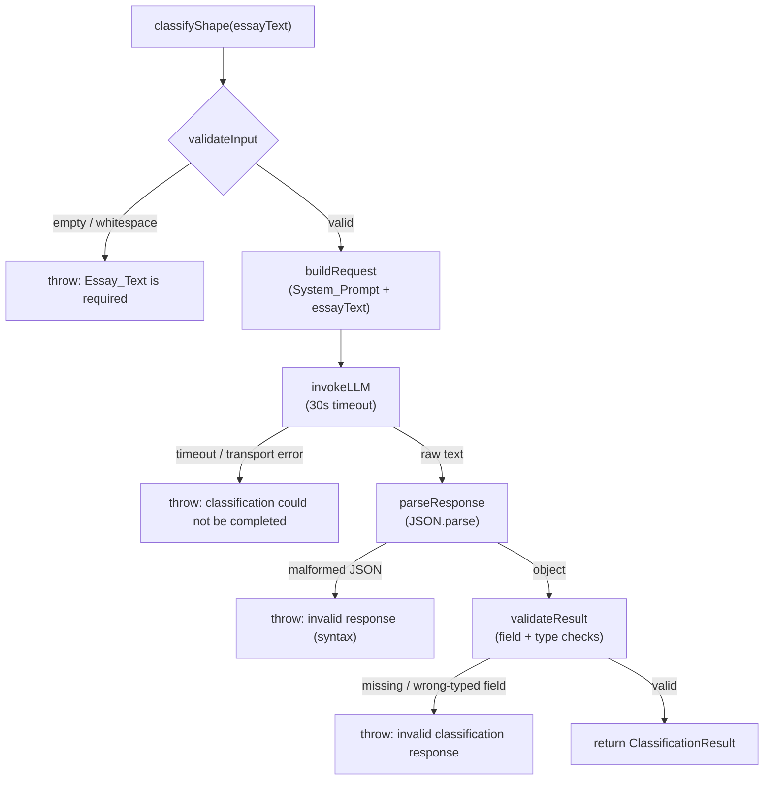

# Design Document

## Overview

The `shape-classifier` feature adds an LLM-backed module (`shape-classifier.ts`) to the EasyDawg admissions evaluator. Where `router.ts` implements pure deterministic scoring logic, this module delegates a judgment task — reading a student's application essay and classifying its narrative shape — to Kiro's large language model (LLM).

The module exposes a single async function, `classifyShape(essayText)`, that:

1. Validates the input (rejecting empty/whitespace essays before any LLM call).
2. Sends the essay text to the LLM alongside a fixed `System_Prompt` that encodes the classification rules, under a 30-second timeout.
3. Parses and strictly validates the LLM's JSON response.
4. Returns a strongly typed `ClassificationResult` with three fields: `shape` (`"linear"` or `"motif"`), `circularity` (a boolean), and `reasoning` (a short string).

The design isolates the two concerns that behave very differently from a testing standpoint:

- **Deterministic logic** — input validation and response parsing/validation — is pure and testable with property-based tests.
- **Non-deterministic I/O** — the LLM request itself (timeout, transport failure) — is verified with mock-based and example tests.

### Design Goals

- Match the TypeScript conventions established in `router.ts`: exported interfaces, JSDoc on exported functions, named exports, and explicit typing.
- Fail fast and loudly: invalid input and malformed LLM output produce descriptive errors rather than silent defaults.
- Keep the LLM interaction behind a thin, mockable seam so the deterministic logic can be tested without network calls.

### Requirements Addressed

- Requirement 1 — the `classifyShape` async function, its signature, validation, timeout, and error behavior.
- Requirement 2 — the `System_Prompt` content encoding shape/circularity rules.
- Requirement 3 — strict JSON parsing and the typed `ClassificationResult`.
- Requirement 4 — project conventions (exported interface, JSDoc, named async export).

## Architecture

The module is organized as a small pipeline. `classifyShape` orchestrates four stages; each stage is a pure, independently testable unit except for the LLM invocation.



### Layering

| Layer | Responsibility | Determinism | Primary test approach |
|-------|----------------|-------------|-----------------------|
| Validation | Reject empty/whitespace `essayText` | Pure | Property + example |
| Prompt assembly | Combine `System_Prompt` with `essayText` | Pure | Example |
| LLM invocation | Send request, enforce 30s timeout, surface failures | Non-deterministic I/O | Mock-based + example |
| Parsing | `JSON.parse` the raw LLM text | Pure | Property (round-trip) + example |
| Validation of result | Enforce field presence and types | Pure | Property + example |

### LLM Seam

The LLM call is wrapped behind an internal function so tests can substitute a mock. The default implementation uses Kiro's LLM capability with a 30-second timeout enforced via `Promise.race` against a timer (or the SDK's native timeout/`AbortSignal` option when available). Keeping this seam narrow lets the deterministic parsing/validation logic be exercised without a live model.

## Components and Interfaces

### Public API

```typescript
/**
 * The structural shape classification produced for an essay.
 */
export interface ClassificationResult {
  /** The narrative shape: "linear" or "motif". */
  shape: ShapeValue;
  /** True when the ending explicitly returns to the exact opening image/scene/question. */
  circularity: boolean;
  /** One short sentence naming the textual evidence for the shape choice. */
  reasoning: string;
}

/** Allowed values for the essay's narrative shape. */
export type ShapeValue = "linear" | "motif";

/**
 * Classifies the structural shape of a student essay using Kiro's LLM.
 *
 * @param essayText The raw student essay text to classify. Must be non-empty
 *   and contain at least one non-whitespace character.
 * @returns A promise resolving to a ClassificationResult describing the essay's
 *   shape ("linear" or "motif"), whether the narrative is circular (boolean),
 *   and a one-sentence reasoning string.
 * @throws If essayText is empty or whitespace-only, if the LLM request fails or
 *   times out after 30 seconds, or if the LLM response is not valid JSON or
 *   does not conform to the ClassificationResult shape.
 */
export async function classifyShape(essayText: string): Promise<ClassificationResult>;
```

### Internal functions

These are not exported; they exist to keep `classifyShape` readable and to make the deterministic stages unit/property testable. They may be exported under a test-only namespace or kept module-private and tested through `classifyShape` with a mocked LLM seam.

| Function | Signature (conceptual) | Purpose |
|----------|------------------------|---------|
| `assertNonEmptyEssay` | `(essayText: string) => void` | Throws `EssayRequiredError` when the trimmed text is empty (Req 1.2). |
| `buildMessages` | `(essayText: string) => LlmRequest` | Assembles the `System_Prompt` + essay into the request payload (Req 1.3, 2.x). |
| `invokeLlm` | `(req: LlmRequest, timeoutMs: number) => Promise<string>` | Sends the request, enforces the 30s timeout, surfaces failures (Req 1.3, 1.9). |
| `parseResponse` | `(raw: string) => unknown` | `JSON.parse` with a wrapped syntax error (Req 3.3). |
| `validateResult` | `(value: unknown) => ClassificationResult` | Checks presence/types of all fields; narrows `unknown` to `ClassificationResult` (Req 1.4–1.8, 3.2–3.5). |

### Constants

```typescript
/** Maximum time to wait for an LLM classification response. */
const LLM_TIMEOUT_MS = 30_000;

/** Fixed instruction set defining the classification rules. */
const SYSTEM_PROMPT: string = /* see "System_Prompt Content" below */;
```

### System_Prompt Content

The `System_Prompt` is a fixed string constant encoding every rule from Requirement 2. It instructs the LLM to:

- Assign `shape = "linear"` when the essay is built around unconnected episodes or a chronological timeline with no recurring anchoring object, metaphor, or image (Req 2.1).
- Assign `shape = "motif"` when the essay returns two or more times to a single specific object, metaphor, or image that anchors the narrative (Req 2.2).
- Prefer `"motif"` when the essay matches both rules (Req 2.3).
- Default to `"linear"` when the essay matches neither rule (Req 2.4).
- Set `circularity = true` only when the ending explicitly returns to the exact opening image, scene, or question; otherwise `false` (Req 2.5, 2.6).
- Produce `reasoning` as exactly one sentence of at most 200 characters naming the specific textual evidence for the shape choice (Req 2.7).
- Respond with **only** a JSON object of the form `{ "shape": "linear" | "motif", "circularity": <boolean>, "reasoning": "<string>" }`, with `circularity` as a JSON boolean (`true`/`false`), never a number or string.

The prompt explicitly states the exact JSON schema and the boolean nature of `circularity` to reduce the chance of malformed output; the deterministic `validateResult` stage remains the authoritative guard.

### Error Model

A small set of named error types (or `Error` subclasses with distinct messages) makes failures programmatically distinguishable:

| Error | Raised when | Requirements |
|-------|-------------|--------------|
| `EssayRequiredError` | `essayText` is empty or whitespace-only | 1.2 |
| `ClassificationTimeoutError` / `ClassificationFailedError` | LLM request fails or exceeds 30s | 1.9 |
| `InvalidResponseError` | Response is not well-formed JSON, is missing a field, or has a wrong-typed/invalid field | 1.8, 3.3, 3.4, 3.5 |

Each error message identifies the specific cause (e.g., the missing field name, the invalid `shape` value, or the JSON syntax fault).

## Data Models

### ClassificationResult

The single returned data structure. All three fields are required.

| Field | Type | Constraints | Source |
|-------|------|-------------|--------|
| `shape` | `ShapeValue` (`"linear" \| "motif"`) | Exactly one of the two literals | Req 1.5, 3.1, 3.4 |
| `circularity` | `boolean` | JSON boolean `true`/`false`; never a number or string | Req 1.6, 3.1, 3.5 |
| `reasoning` | `string` | Non-empty, at most 2000 characters (one sentence ≤ 200 chars per the prompt) | Req 1.7, 2.7, 3.1 |

### LLM request/response shapes (internal)

- **Request**: `{ systemPrompt: string; userText: string }` conceptually — the fixed `System_Prompt` plus the `essayText`.
- **Raw response**: a `string` of text returned by the LLM, expected to contain a JSON object. It is parsed by `parseResponse` and validated by `validateResult` before becoming a `ClassificationResult`.

### Validation rules (authoritative, enforced in code)

`validateResult` accepts a parsed `unknown` and enforces, in order:

1. The value is a non-null object.
2. `shape` exists and is exactly `"linear"` or `"motif"` — otherwise `InvalidResponseError` naming the bad value (Req 1.8, 3.4).
3. `circularity` exists and is of type `boolean` — otherwise `InvalidResponseError` naming the bad value (Req 1.8, 3.5). A numeric or string `circularity` is rejected.
4. `reasoning` exists and is a non-empty `string` of at most 2000 characters — otherwise `InvalidResponseError` (Req 1.7, 1.8, 3.1).

Only when all checks pass is the value returned as a `ClassificationResult`.

## Correctness Properties

*A property is a characteristic or behavior that should hold true across all valid executions of a system — essentially, a formal statement about what the system should do. Properties serve as the bridge between human-readable specifications and machine-verifiable correctness guarantees.*

These properties apply to the feature's **deterministic** layers: input validation and response parsing/validation. The LLM's judgment itself (how it decides linear vs motif, or circularity) is non-deterministic and is covered by example and integration tests rather than properties. The `System_Prompt` content rules (Requirement 2) are prompt-text assertions, not universal properties, so they appear in the Testing Strategy, not here.

### Property 1: Empty or whitespace-only input is always rejected before any LLM call

*For any* string consisting solely of whitespace characters (including the empty string, spaces, tabs, and newlines in any combination), invoking `classifyShape` SHALL reject with an error indicating that Essay_Text is required, and the LLM seam SHALL NOT be invoked.

**Validates: Requirements 1.2**

### Property 2: Valid LLM output round-trips to a conforming ClassificationResult

*For any* valid `ClassificationResult` value (`shape` in {`"linear"`, `"motif"`}, `circularity` a boolean, `reasoning` a non-empty string of at most 2000 characters), when that value is serialized to JSON and supplied as the LLM response, `classifyShape` SHALL return a `ClassificationResult` that is equal to the original value — with `shape` one of the two allowed literals, `circularity` of type boolean, and `reasoning` a string.

**Validates: Requirements 1.4, 1.5, 1.6, 1.7, 3.2**

### Property 3: Any malformed or invalid LLM response is rejected with no result

*For any* LLM response that is either not well-formed JSON, or is a JSON value that is not an object, or is missing one of the fields `shape`/`circularity`/`reasoning`, or has `shape` set to a string outside {`"linear"`, `"motif"`}, or has `circularity` set to a non-boolean value (number, string, null, or object), or has `reasoning` set to a non-string or empty string, `classifyShape` SHALL reject with an error identifying the specific fault and SHALL NOT return a `ClassificationResult`.

**Validates: Requirements 1.8, 3.3, 3.4, 3.5**

## Error Handling

All failure modes surface as rejected promises with descriptive, type-distinguishable errors. No failure mode returns a partial or defaulted `ClassificationResult`.

| Condition | Error | Message identifies | Requirements |
|-----------|-------|--------------------|--------------|
| `essayText` empty or whitespace-only | `EssayRequiredError` | That a non-empty Essay_Text is required | 1.2 |
| LLM request throws / rejects | `ClassificationFailedError` | That the classification could not be completed | 1.9 |
| LLM does not respond within 30s | `ClassificationTimeoutError` | That the 30s timeout elapsed | 1.9 |
| Response is not well-formed JSON | `InvalidResponseError` | The JSON syntax fault | 3.3 |
| Response missing a required field | `InvalidResponseError` | The specific missing field name | 1.8, 3.3 |
| `shape` not `"linear"`/`"motif"` | `InvalidResponseError` | The invalid `shape` value | 1.8, 3.4 |
| `circularity` not a boolean | `InvalidResponseError` | The invalid `circularity` value and its type | 1.8, 3.5 |
| `reasoning` not a non-empty string ≤ 2000 chars | `InvalidResponseError` | The invalid `reasoning` value | 1.7, 1.8, 3.1 |

Design notes:

- **Validate before calling the LLM.** `assertNonEmptyEssay` runs first so that an invalid essay never incurs a network call (Req 1.2). Tests assert the mock was never invoked.
- **Timeout is enforced in code, not left to the caller.** `invokeLlm` races the request against a 30-second timer (or uses an `AbortSignal`), so a hung model becomes a `ClassificationTimeoutError` rather than an indefinite wait (Req 1.3, 1.9).
- **Parse and validate are separate stages** so that a JSON syntax error and a schema violation produce distinct, specific messages (Req 3.3 vs 1.8/3.4/3.5).
- **`circularity` is strictly boolean.** `validateResult` rejects `0`, `1`, `"true"`, `"false"`, `null`, and any non-boolean outright — the type is never coerced (Req 1.6, 3.5).

## Testing Strategy

The feature splits cleanly into deterministic logic (property-tested) and non-deterministic I/O / fixed-text assertions (example- and mock-tested). The LLM seam is mocked in all unit and property tests so the deterministic pipeline is exercised without network calls or model variability.

### Property-based tests

Property-based testing **is** appropriate here for validation and parsing: these are pure functions over a large input space (arbitrary strings, arbitrary JSON values, arbitrary field combinations), and "for all inputs" statements hold deterministically.

- Use `fast-check` (the standard property-based testing library for TypeScript/JavaScript). Do **not** hand-roll property testing.
- Each property test runs a **minimum of 100 iterations** (`fc.assert(..., { numRuns: 100 })` or higher).
- Each property test is tagged with a comment referencing its design property, using the format:
  `// Feature: shape-classifier, Property {number}: {property text}`
- Mapping:
  - **Property 1** → generate whitespace-only strings (`fc` generators over whitespace characters plus the empty string); assert rejection with `EssayRequiredError` and that the mocked LLM seam was never called.
  - **Property 2** → generate valid `ClassificationResult` values (`shape` from the two literals, `circularity` an arbitrary boolean, `reasoning` an arbitrary non-empty string ≤ 2000 chars), `JSON.stringify` as the mocked LLM output, and assert the returned object deep-equals the generated one.
  - **Property 3** → generate invalid responses (malformed JSON strings; non-object JSON; objects missing one field; `shape` set to arbitrary non-member strings; `circularity` set to non-boolean values including `0`/`1`/`"true"`/`null`; `reasoning` non-string or empty); assert `classifyShape` rejects with `InvalidResponseError` and returns no result.

### Example and unit tests

- **Signature / export checks (Req 1.1, 4.1, 4.3, SMOKE)**: assert `classifyShape` is a named, exported async function accepting a string, and that `ClassificationResult` is exported with the three declared members (compile-time type assertion).
- **`System_Prompt` content (Req 2.1–2.7, EXAMPLE)**: assert the `SYSTEM_PROMPT` constant contains the wording for each rule — linear rule, motif rule, both-match → motif tie-break, neither-match → linear default, circularity true/false conditions, and the one-sentence/≤200-char/textual-evidence reasoning instruction. These guard against accidental edits to the prompt; they do not test the LLM's judgment.
- **JSDoc presence (Req 4.2, SMOKE)**: lint/inspection check that `classifyShape` carries a JSDoc block documenting `essayText` and the returned `ClassificationResult`.

### Integration / mock-based tests

These cover the LLM interaction, whose behavior does not vary meaningfully with essay content and would be costly or non-deterministic to run many times.

- **Request assembly (Req 1.3, INTEGRATION)**: with a mocked LLM seam, call `classifyShape` with a representative non-empty essay and assert the seam was called once with a payload containing both the `System_Prompt` and the `essayText`, and that a 30-second timeout is configured.
- **Transport failure (Req 1.9, INTEGRATION)**: mock the seam to reject; assert `classifyShape` rejects with `ClassificationFailedError`.
- **Timeout (Req 1.9, INTEGRATION)**: mock the seam to never resolve within the window (using fake timers); assert `classifyShape` rejects with `ClassificationTimeoutError` after 30 seconds.
- **End-to-end smoke (optional, manual/CI-gated)**: a small number of real-LLM runs over representative essays to qualitatively confirm the prompt yields sensible `shape`/`circularity`/`reasoning` — not part of the deterministic test suite.

### Coverage summary

| Requirement | Test type |
|-------------|-----------|
| 1.1, 3.1, 4.1, 4.2, 4.3 | Smoke / compile-time |
| 1.2 | Property 1 |
| 1.3 | Integration (mock) |
| 1.4, 1.5, 1.6, 1.7, 3.2 | Property 2 |
| 1.8, 3.3, 3.4, 3.5 | Property 3 |
| 1.9 | Integration (mock, fake timers) |
| 2.1–2.7 | Example (prompt-content assertions) |
